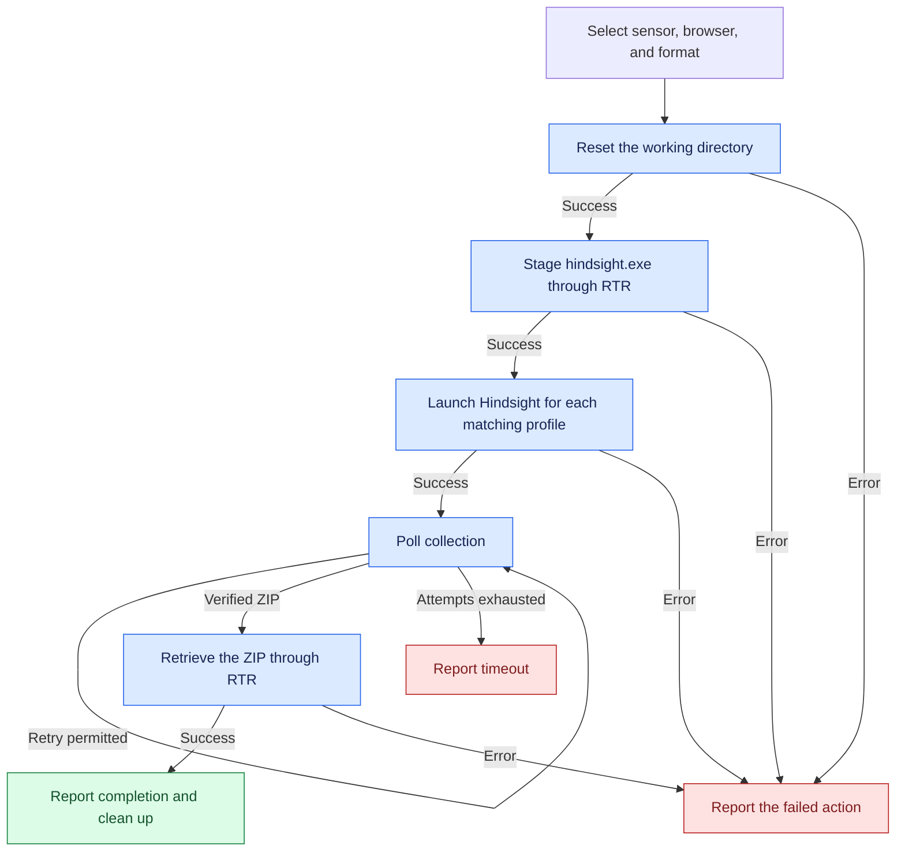

# Workflow and troubleshooting

Fusion orchestrates RTR actions and keeps track of their outputs. The PowerShell scripts run on the Windows endpoint. See [setup](setup.md) for the script schemas and action mappings.

## From trigger to retrieval

## What each script does

### 1. Prepare the endpoint

[Prepare](../scripts/prepare.ps1) takes `forensic_analysis_path`. If that path exists, it recursively removes it and its contents, then recreates the directory. It returns the path for subsequent actions. A reset or creation failure returns `has_processing_errors: true` and `exception_messages`.

> [!IMPORTANT]
> Use a directory dedicated to Hindsight. Sequential runs can reuse it. Overlapping runs on the same endpoint need separate directories because preparation clears everything at the supplied path.

### 2. Launch Hindsight

[Process](../scripts/process.ps1) validates the browser, output format, and hostname. It resolves the interactive Windows user's local profile and looks for browser directories named `Default` or `Profile <number>`. It launches one Hindsight process per matching profile with UTC output and records the process ID, start time, and expected output path in `hindsight-<analysis_timestamp>.json`.

Fusion gets the profile names and paths, the expected `forensic_results`, and the `analysis_timestamp`. The result describes what was launched. Collection checks those expected paths against the process record.

### 3. Verify and retrieve the ZIP

[Collect](../scripts/collect.ps1) performs one check per Fusion poll. It verifies that the process record matches the expected files, that none of the recorded processes is still running, and that every expected file exists and is non-empty. The process start time helps distinguish Hindsight from a different process that reused its ID.

The collector builds a temporary ZIP, verifies its entry count, names, and sizes, then moves it to the final path. Fusion can start RTR Get File when collection returns `has_processing_errors: false` and a `zip_file_path`. On an unsuccessful attempt, use `exception_messages` to diagnose the result. After the polling limit, report a timeout.

The collector cannot determine Hindsight's exit code after the launch action returns. Confirm that the reports open and contain the expected data during the first Windows test run.

## Troubleshooting

| Symptom | Where to look |
| --- | --- |
| Preparation fails to reset the directory | Read `exception_messages`. Check the configured path, RTR permissions, and whether an open file is preventing removal. |
| Process reports no interactive user or matching profiles | Check for a signed-in user on the selected sensor and confirm the selected browser has a supported profile under that user's local profile. |
| Process fails to launch Hindsight | Read `exception_messages` and confirm the Put File action staged the expected executable at `forensic_tool_path`. |
| Collection keeps polling | Read the latest `exception_messages`. A recorded process can still be active, or an output file can be absent or empty. A missing process record can indicate scripts from different revisions. |
| Polling times out | Inspect the last collection response and confirm the timeout branch bypassed retrieval. |
| Get File fails | Inspect the RTR action result and confirm the supplied path matches the successful collection output. |
| Cleanup is incomplete | Inspect the cleanup action and confirm its target equals `forensic_analysis_path` returned by preparation. |

The June 2025 screenshots show the original Fusion configuration. Use them as references for the action locations. [Published revision](https://github.com/alexandruhera/crowdstrike-hindsight-soar/tree/7bf009c) · [Polling configuration](https://github.com/user-attachments/assets/20e18ed6-fd69-4de0-ace0-78411486a042) · [Falcon archive download](https://github.com/user-attachments/assets/517bfd0b-2fbc-47ff-97d1-5814e32ae646)
