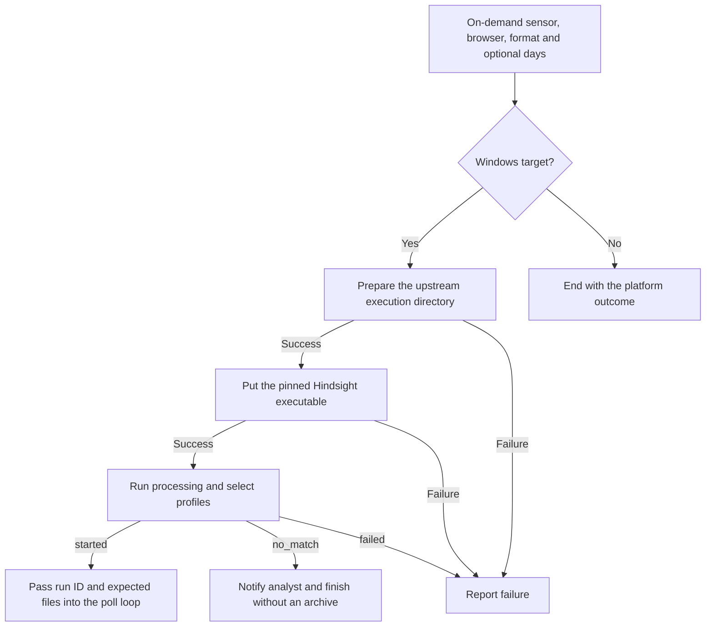
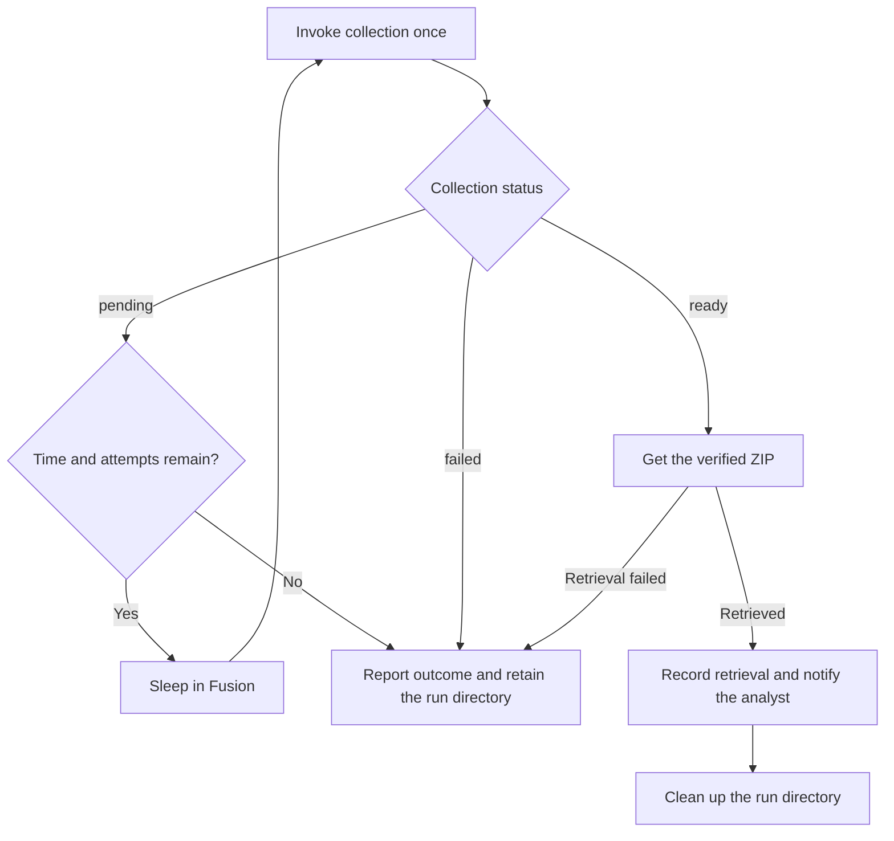

# Fusion workflow and archive collection

These diagrams show the Fusion bindings for the current scripts. The [June 2025 diagrams](https://github.com/alexandruhera/crowdstrike-hindsight-soar/blob/2fb6bf7/docs/workflow.md) document the original deployment. The upstream workflow owns the directory, loop limit, retrieval and cleanup.

## From trigger to collection

Fusion passes optional days only to processing. Processing returns promptly after launching background work. Keep the same run ID and list of expected files for every collection attempt. The absence of qualifying profiles is a valid result to show the analyst.

## Polling and retrieval

A result filename may appear before Hindsight finishes writing. The collector checks completion records for the same run and verifies the archive before returning its path. Use an explicit success branch after the loop. Reaching the iteration or time limit also exits a loop and needs its own terminal outcome. [Operator setup and field mappings](../README.md)
