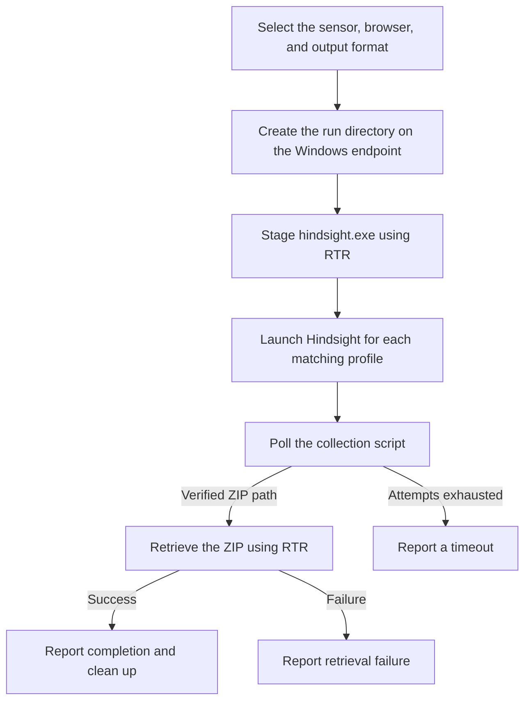

# Workflow and troubleshooting

Fusion orchestrates RTR actions and keeps track of their outputs. The PowerShell scripts run on the Windows endpoint. See [setup](setup.md) for the script schemas and action mappings.

## From trigger to retrieval

[Processing](../scripts/process.ps1) finds the interactive Windows user's local profile and looks for browser directories named `Default` or `Profile <number>`. It launches Hindsight asynchronously and records each process with its expected output path. The launch response lists expected files. The run log and retrieval action show when an archive is available.

[Collection](../scripts/collect.ps1) checks the process records and waits for the recorded processes to exit across polling attempts. It checks for non-empty output files, creates a ZIP, and verifies the entries and their sizes before publishing the archive path. The collector cannot determine Hindsight's exit code after the launch action has returned. Open the reports in the first test run to validate their contents.

## Troubleshooting

| Symptom | Where to look |
| --- | --- |
| Preparation rejects the directory | Check that Fusion generated a fresh path. A directory left by an earlier run can contain evidence. |
| Process reports no interactive user or matching profiles | Check for a signed-in user on the selected sensor and confirm the selected browser has a supported profile under that user's local profile. |
| Process fails to launch Hindsight | Read `exception_messages` and confirm the Put File action staged the expected executable at `forensic_tool_path`. |
| Collection keeps polling | Read the latest `exception_messages`. A recorded process can still be active, or an output file can be absent or empty. A missing process record can indicate scripts from different revisions. |
| Polling times out | Inspect the last collection response and confirm the timeout branch bypassed retrieval. |
| Get File fails | Inspect the RTR action result and confirm the supplied path matches the successful collection output. |
| Cleanup is incomplete | Inspect the cleanup action and confirm its target equals `forensic_analysis_path` returned by preparation. |

The June 2025 screenshots show the original Fusion configuration. Use them as references for the action locations. [Published revision](https://github.com/alexandruhera/crowdstrike-hindsight-soar/tree/7bf009c) · [Polling configuration](https://github.com/user-attachments/assets/20e18ed6-fd69-4de0-ace0-78411486a042) · [Falcon archive download](https://github.com/user-attachments/assets/517bfd0b-2fbc-47ff-97d1-5814e32ae646)
