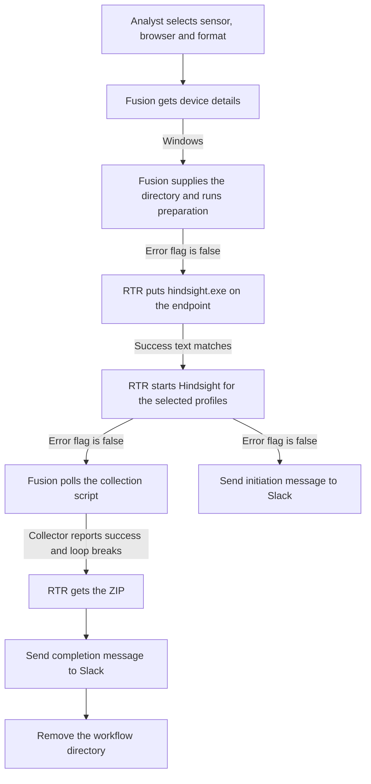
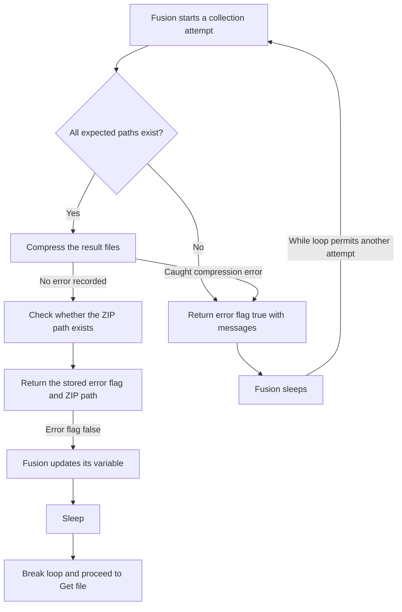

# Browser forensics with Falcon Fusion and Hindsight

An analyst starts an on-demand Falcon Fusion workflow for one sensor, browser and output format. Fusion chooses the working directory, runs short RTR actions on the Windows endpoint, and polls for the results. Hindsight runs asynchronously so a large browser profile can continue processing after the RTR launch action returns. The diagrams describe the published June 2025 workflow. [Source revision](https://github.com/alexandruhera/crowdstrike-hindsight-soar/tree/7bf009c) · [Trigger inputs](../trigger-input.json)

## Deploying the revised scripts

Update preparation, processing and collection together. Processing records the Hindsight processes it launches in the run directory. Collection expects that record, waits for the recorded processes to exit, and checks the ZIP entries before returning its path. Process exit and archive checks do not establish Hindsight's exit code after the launch script has returned.

Assign each run a fresh working directory in Fusion and use the path returned by preparation for every later step, including cleanup. Preparation rejects an existing directory. Gate retrieval on an explicit successful collection result with a ZIP path. Verify the timeout branch and the cleanup target in the deployed Fusion workflow.

## From trigger to retrieval

The diagram follows the successful Windows branch. Preparation recreates the directory supplied by Fusion. The pictured Put file condition matches the words “Operation completed successfully” in standard output. Processing resolves the signed-in user's browser directory and starts Hindsight for matching profiles, such as `Default` and `Profile 1`. Its `forensic_results` output lists expected paths. The Slack initiation message reports launch. A completed Get file action exposes the archive for download in Falcon. [Preparation and platform gate](https://github.com/user-attachments/assets/2930ad99-84bd-4fec-a5b2-2398f3c096a6) · [Upload and launch gates](https://github.com/user-attachments/assets/94d1dc94-8961-44e8-bb30-01d4e48f2a62) · [Processing script](../001-hindsight-processing.ps1) · [Download example](https://github.com/user-attachments/assets/517bfd0b-2fbc-47ff-97d1-5814e32ae646)

## What Fusion checks on each poll

The collector makes one attempt each time Fusion calls it. It checks every expected path and tries to compress the files when all paths exist. Fusion sends a true `has_processing_errors` result to Sleep. A false value follows Update variable, Sleep and Loop break. The screenshot shows a limit of 15 iterations and 15 minutes. It shows Get file after the loop. The outcome of reaching either limit without a successful attempt needs verification in the deployed workflow. [Published loop](https://github.com/user-attachments/assets/20e18ed6-fd69-4de0-ace0-78411486a042) · [Retrieval and cleanup](https://github.com/user-attachments/assets/92b4e455-aac2-448e-b31f-7235f8ffd3c1)

Two details affect how to interpret that false flag. First, a Hindsight output path can appear while Hindsight is still writing. A collection attempt can therefore archive incomplete data. Second, the collector computes its error flag before its final ZIP existence check. If that check detects a missing ZIP, the script records the exception internally and can still emit a false error flag and the missing path. [Collection script](../001-hindsight-collection.ps1)
